<p align="center">
  <a href="https://sponsuno.ch">
    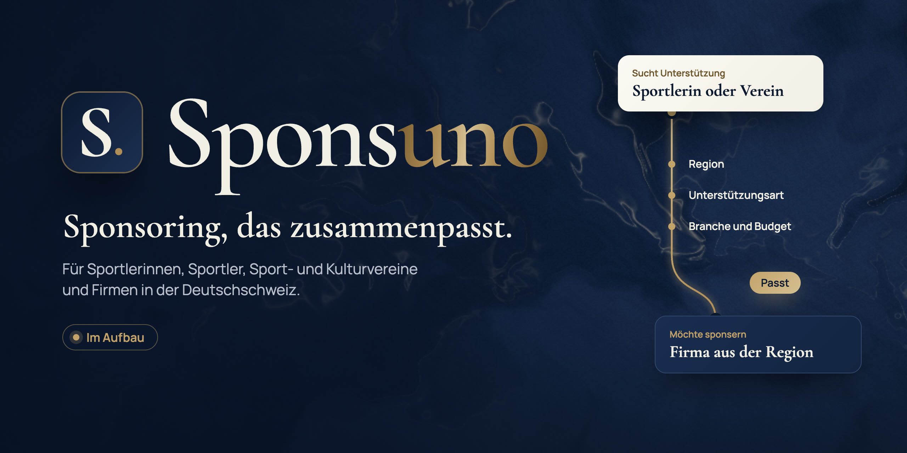
  </a>
</p>

<p align="center">
  <a href="https://sponsuno.ch"></a>
  
  
</p>
<p align="center">
  
  
  
  
  
  
</p>

<p align="center">
  <b>Sponsuno bringt Sportlerinnen und Sportler, Sport- und Kulturvereine mit Firmen aus ihrer Region zusammen.</b><br>
  Ein persönlicher KI-Sponsoringmanager soll danach bei Anfragen, Terminen und Gegenleistungen helfen.<br>
  Das ist die Startseite dazu: ein Projekt im Youngpreneurs-Programm.
</p>

<p align="center">
  <a href="https://sponsuno.ch"><b>Live ansehen</b></a>
  &nbsp;&nbsp;|&nbsp;&nbsp;
  <a href="#was-drin-steckt">Was drin steckt</a>
  &nbsp;&nbsp;|&nbsp;&nbsp;
  <a href="#technik">Technik</a>
  &nbsp;&nbsp;|&nbsp;&nbsp;
  <a href="#design-system">Design-System</a>
  &nbsp;&nbsp;|&nbsp;&nbsp;
  <a href="#lokal-starten">Lokal starten</a>
</p>

<br>

## Der Moment

Eine Mountainbikerin aus dem Zürcher Oberland sucht Material, ein Velogeschäft aus derselben Region möchte sponsern. Ein goldener Faden läuft von der einen Karte zur anderen und hakt dabei Region, Unterstützungsart, Branche und Budget ab. Im Hintergrund fliesst ein Seiden-Shader in Navy und Gold, der auf die Maus reagiert.

<p align="center">
  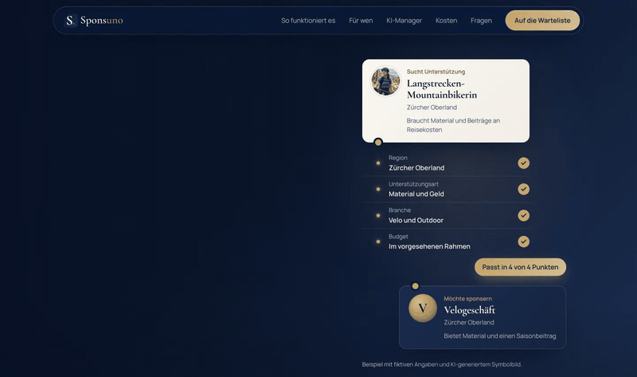
</p>
<p align="center"><sub>Aufgenommen auf der Live-Seite. Beispiel mit fiktiven Angaben und KI-generiertem Symbolbild.</sub></p>

<br>

## Was drin steckt

<table>
  <tr>
    <td width="50%" valign="top">
      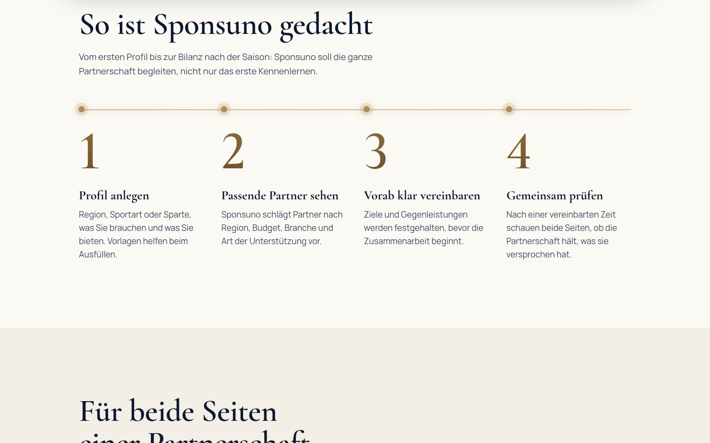
      <h3>Ablauf mit Goldlinie</h3>
      Die Linie füllt sich beim Scrollen, jeder Punkt leuchtet auf, sobald sie ihn erreicht. Die Ziffern rollen von unten ins Bild.
    </td>
    <td width="50%" valign="top">
      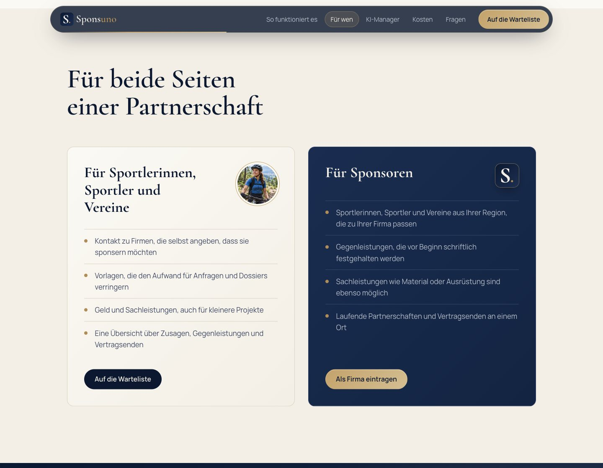
      <h3>Zwei Seiten, zwei Karten</h3>
      Eine helle und eine dunkle Karte für die beiden Seiten einer Partnerschaft. Beide kippen leicht mit der Maus und tragen einen Lichtreflex.
    </td>
  </tr>
  <tr>
    <td width="50%" valign="top">
      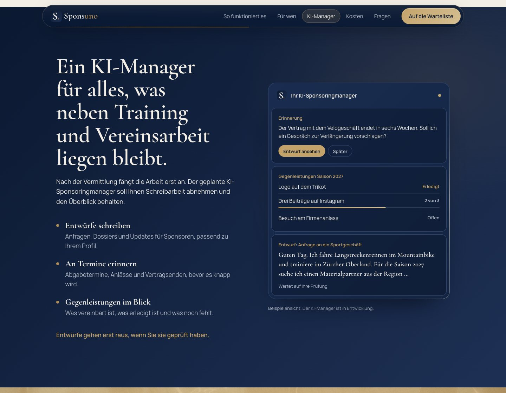
      <h3>KI-Sponsoringmanager</h3>
      Das Panel baut sich beim Hinscrollen auf: Erinnerung, Gegenleistungen mit Fortschritt, und ein Entwurf, der sich selbst tippt. Ein Lichtstreifen umrundet den Rahmen.
    </td>
    <td width="50%" valign="top">
      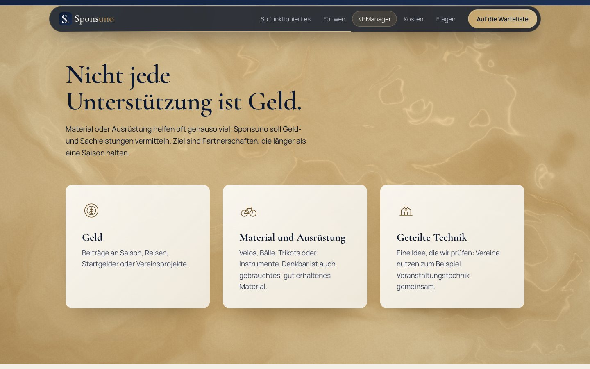
      <h3>Flüssiges Gold</h3>
      Derselbe Shader in der Goldpalette, ruhiger hinter dem Text. Die Karten folgen dem CD: Elfenbein auf Gold, ohne Rahmen.
    </td>
  </tr>
  <tr>
    <td width="50%" valign="top">
      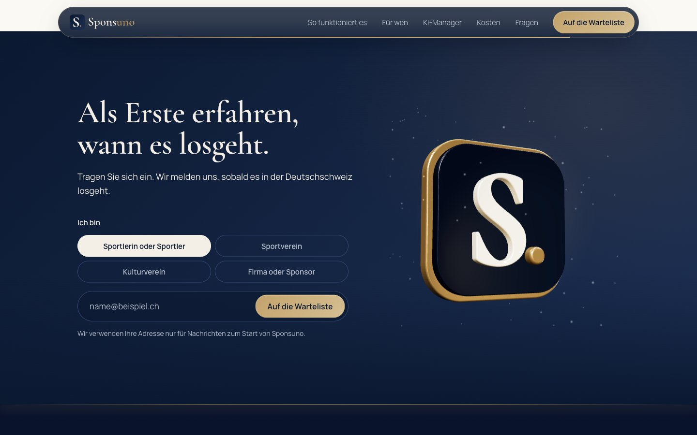
      <h3>Das Logo in 3D</h3>
      Das Icon wird direkt aus dem Logo-SVG extrudiert: Navy-Emaille, Goldrahmen, Goldpunkt, schwebender Goldstaub. Nach der Anmeldung dreht es sich einmal und sprüht Funken.
    </td>
    <td width="50%" valign="top">
      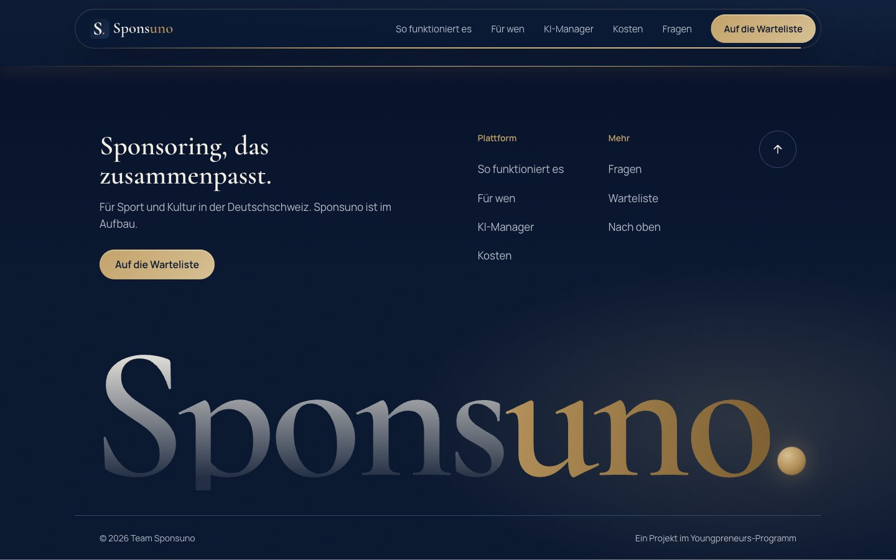
      <h3>Footer mit Wortmarke</h3>
      «Sponsuno.» über die ganze Breite. Über das «uno» zieht ein Goldglanz, ein Licht folgt dem Mauszeiger, und die Buchstaben steigen beim Scrollen auf.
    </td>
  </tr>
</table>

### Auf dem Handy

<table>
  <tr>
    <td align="center" width="33%">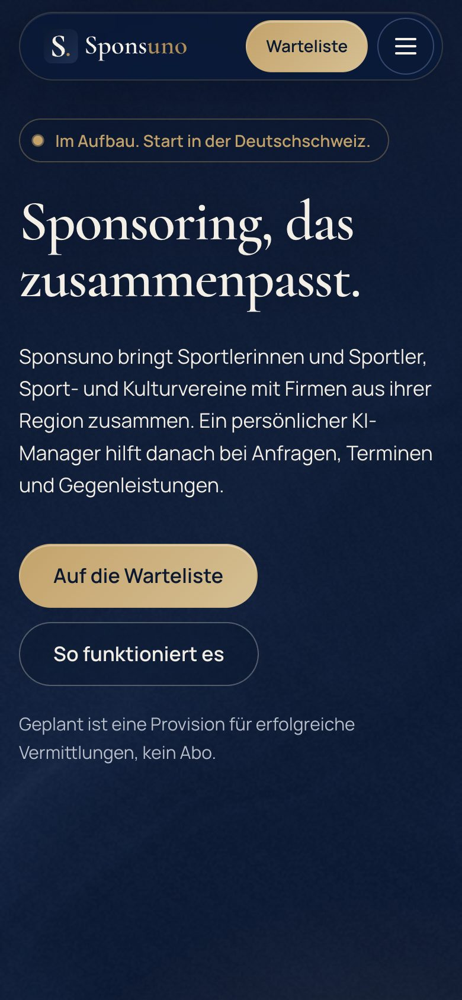<br><sub>Kompakter Header mit Wartelisten-Button</sub></td>
    <td align="center" width="33%">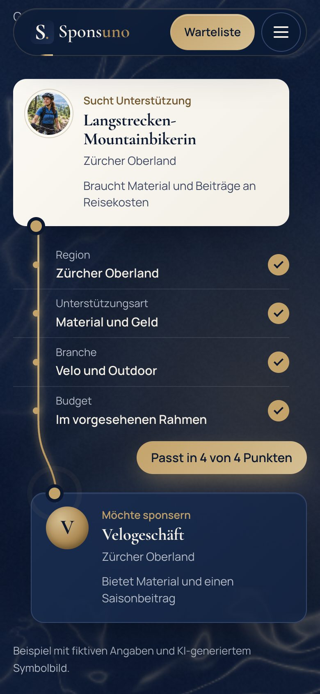<br><sub>Das Match startet, sobald es im Bild ist</sub></td>
    <td align="center" width="33%">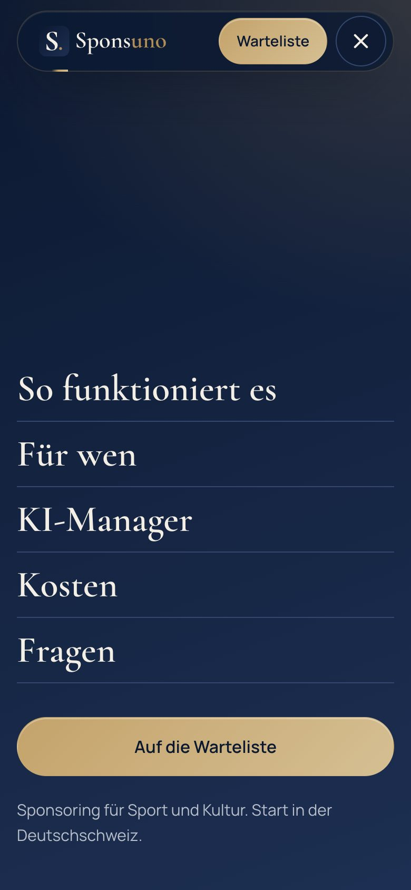<br><sub>Vollbild-Menü als modaler Dialog</sub></td>
  </tr>
</table>

<br>

## Technik

Vite, React 19 und TypeScript im Strict-Modus. Die Seite wird beim Build vorgerendert, damit Inhalt und Suchmaschinen nicht auf JavaScript warten müssen; React übernimmt danach im Browser. Alle Texte stehen typisiert in [`src/content.ts`](src/content.ts).

| Teil | Umsetzung |
| --- | --- |
| Seiden-Shader | Eigener WebGL-Fragment-Shader mit Domain-Warping ([`src/lib/silk.ts`](src/lib/silk.ts)). Rendert mit 42 bis 60 % der Auflösung, pausiert ausserhalb des Sichtfelds und in Hintergrund-Tabs. |
| 3D-Emblem | Three.js, Logo-SVG per `SVGLoader` extrudiert, Studio-Licht über `RoomEnvironment` ([`src/lib/emblem.ts`](src/lib/emblem.ts)). Eigener Chunk, wird erst geladen, wenn man in die Nähe scrollt. |
| Scroll-Choreografie | GSAP mit ScrollTrigger und `useGSAP`, sanftes Scrollen mit Lenis ([`src/lib/motion.ts`](src/lib/motion.ts)). |
| Vorrendern | `renderToString` beim Build ([`src/entry-server.tsx`](src/entry-server.tsx), [`scripts/prerender.mjs`](scripts/prerender.mjs)), im Browser `hydrateRoot`. |
| Hero-Match | SVG-Pfad mit `stroke-dashoffset`, der Funke folgt `getPointAtLength`. Jedes Kriterium hakt ab, wenn der Faden seine Zeile erreicht ([`src/lib/match.ts`](src/lib/match.ts)). |
| Header | Schwebende Glas-Pille, goldener Marker gleitet zum aktiven Abschnitt, Fortschrittslinie, blendet sich beim Runterscrollen aus. |
| Barrierefreiheit | Bei «Bewegung reduzieren» bleibt alles still. Menü als modaler Dialog mit `inert`, Laufband pausierbar, Fokus sichtbar, Fehlermeldungen werden vorgelesen. |

### Gemessen

Mobil mit vierfach gedrosselter CPU und Fast 4G, am 2. November 2026 (statische Vorgängerversion; die React-Version wird vorgerendert und hält dasselbe Ziel):

| Largest Contentful Paint | Cumulative Layout Shift | Best Practices | SEO |
| :---: | :---: | :---: | :---: |
| **1,6 s** | **0,03** | **100** | **100** |

<br>

## Design-System

Alles folgt dem Sponsuno CD Manual v1.0. Navy und Elfenbein tragen die Seite, Gold setzt Akzente.

<p>
  
  
  
  
  
  
</p>

| Rolle | Schrift |
| --- | --- |
| Titel, Kartentitel, Wortmarke | **Cormorant Garamond** 600 und 700 |
| Fliesstext, Beschriftungen, Buttons | **Manrope** 400 und 600 |

Texte in Hochdeutsch mit Schweizer Schreibweise, sachlich und ohne Werbefloskeln. Was noch nicht entschieden ist, steht als offen da.

<br>

## Lokal starten

Node 20.19 oder neuer.

```bash
git clone https://github.com/platret/sponsuno.git
cd sponsuno
npm install
npm run dev
```

Dann http://localhost:5173/ öffnen. Weitere Befehle: `npm run build` (Typprüfung, Build und Vorrendern nach `dist/`), `npm run preview` (den Build lokal ansehen), `npm run typecheck`.

```
sponsuno/
├── index.html              Vite-Einstieg, Schriften, Meta-Tags
├── demo/index.html         Klickbarer Prototyp (/demo/)
├── impressum/index.html    Impressum (/impressum/), vorgerendert, ohne JavaScript
├── datenschutz/index.html  Datenschutzerklärung (/datenschutz/), vorgerendert, ohne JavaScript
├── sponsoren-finden/ …     Vier Ratgeber (/sponsoren-finden/, /sponsoring-anfrage/, /sponsoring-dossier/,
│                           /kultursponsoring/), vorgerendert, ohne JavaScript
├── fuer-firmen/ …          Themenseiten aus dem Header (/fuer-firmen/, /ki-manager/, /kosten/, /fragen/,
│                           /ueber-uns/), vorgerendert, ohne JavaScript
├── src/
│   ├── App.tsx             Reihenfolge der Abschnitte, Scrollen, Anker-Links
│   ├── content.ts          Alle Texte der Seite, typisiert
│   ├── pages.ts            Alle Seiten mit Titel und Beschreibung (Head-Tags, Sitemap)
│   ├── components/         Ein Bauteil pro Abschnitt, dazu Header, Menü, Match, Emblem
│   ├── hooks/              Scroll-Reveals, Kippen, magnetische Buttons
│   ├── lib/                motion.ts, match.ts, silk.ts (Shader), emblem.ts (3D)
│   ├── styles/site.css     Design-Tokens aus dem CD und alle Styles
│   └── assets/             Logos und Symbolbild
├── scripts/prerender.mjs   Vorrendern beim Build, Head-Tags und sitemap.xml
├── scripts/og/, icons.mjs  Quellen für Vorschaubild und Icons in public/
├── .github/workflows/      Vorschau bei Pull Requests, Deploy von main (Cloudflare)
├── wrangler.jsonc          Cloudflare Worker: Domains und Assets
├── AGENTS.md               Regeln und Architektur für jede Session
├── DESIGN.md               Farben, Schrift, Komponenten, Bewegung
└── docs/                   Bilder für dieses README
```

Deploy: Jeder Push auf `main` baut die Seite und veröffentlicht sie über Cloudflare Workers auf https://sponsuno.ch. Pull Requests bekommen eine Vorschau-URL. Details in [AGENTS.md](AGENTS.md#deploy).

<br>

## Vor dem Launch

- [ ] Warteliste an einen Dienst anbinden: Repository-Variable `VITE_WAITLIST_ENDPOINT` setzen (JSON-POST mit `{ rolle, email }`). Bis dahin speichert das Formular nichts.
- [x] Impressum und Datenschutzerklärung (`/impressum/`, `/datenschutz/`). Offen: Postadresse und Kontakt-E-Mail; vor dem Freischalten der Warteliste den Abschnitt «Warteliste» anpassen.
- [ ] Provisionsmodell festlegen: Höhe, Auslöser und welche Seite sie trägt sind noch offen.
- [ ] 3D-Emblem und Wortmarken-Effekt mit dem Branding abstimmen (das CD sieht beim Logo keine Effekte vor).
- [x] Handy, Tablet und Desktop, «Bewegung reduzieren», Lazy-Loading, Tastaturbedienung.

<br>

## Mitarbeiten

Bevor du etwas änderst: [AGENTS.md](AGENTS.md) (Architektur, Regeln für Texte, Leistung, Barrierefreiheit, Deploy) und [DESIGN.md](DESIGN.md) (Farben, Schrift, Komponenten, Bewegung). Beide gelten für Menschen und KI-Sessions gleichermassen.

<br>

## Design-Referenzen

Recherchiert über [Mobbin](https://mobbin.com): Function (Ablauf mit Serifen), Trawelt (grosse Schrittziffern), Upwork (Aufteilung nach Zielgruppen), Superhuman und Intercom (KI-Assistent mit Vorschau), Origin und Slash (dunkler Hero mit Serifentitel), Base (Warteliste).

<br>

<p align="center">
  
</p>
<p align="center">
  <sub>Team Sponsuno · Youngpreneurs-Programm · Start in der Deutschschweiz</sub>
</p>
