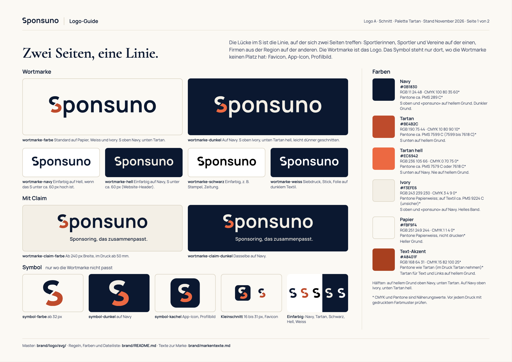
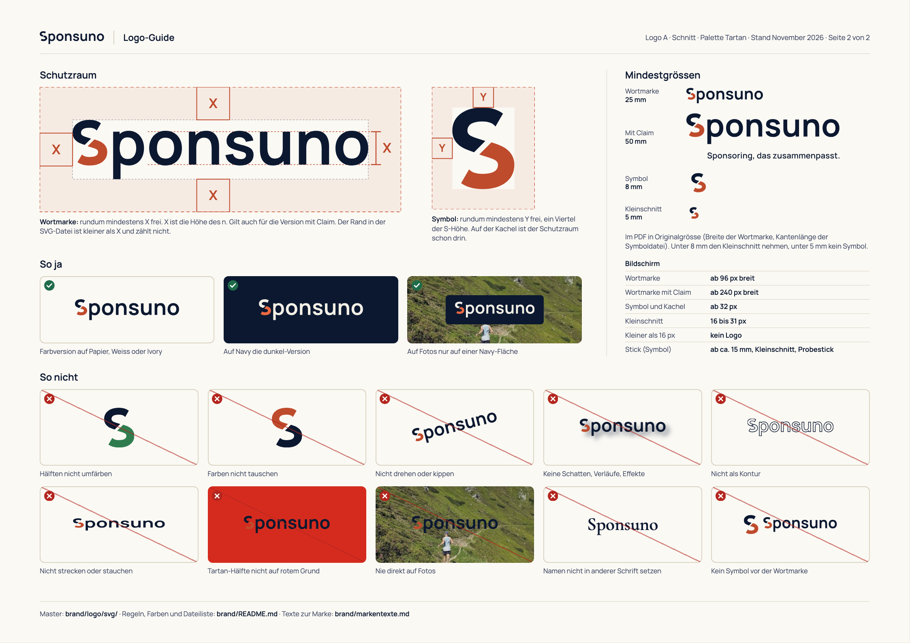

# Sponsuno: Logo und Marke

<picture>
  <source media="(prefers-color-scheme: dark)" srcset="logo/png/wortmarke-dunkel-600.png">
  
</picture>

**Die Idee in einem Satz:** Das S ist einmal schräg durchgeschnitten, und auf dieser Linie treffen sich zwei Seiten:
Sportlerinnen, Sportler und Vereine auf der einen, Firmen aus der Region auf der anderen.

Dieser Ordner enthält alles, was es braucht, um das Logo richtig einzusetzen: Logo-Dateien, Farben, Regeln und Texte.
Logo «A · Schnitt», Palette «Tartan». Stand November 2026.

Kurz und zum Ausdrucken: [Logo-Guide als PDF](logo-guide/logo-guide.pdf) (2 Seiten A4 quer).

[](logo-guide/logo-guide.pdf)

## Die fünf wichtigsten Regeln

1. **Die Wortmarke ist das Logo.** Das Symbol (das S allein) nur dort, wo die Wortmarke keinen Platz hat: Favicon,
   App-Icon, Profilbild. Nie Symbol und Wortmarke nebeneinander.
2. **Nur die Dateien aus diesem Ordner verwenden.** Das Logo nie abtippen, nachzeichnen oder umfärben.
3. **Auf hellem Grund die Farbversion, auf Navy die dunkel-Version.** Klein (S unter ca. 60 px) einfarbig: auf Hell
   `-navy`, auf Navy `-hell`. Nie direkt auf ein Foto oder eine Farbfläche, sondern auf ein Feld in Navy, Papier oder Weiss.
4. **Rundum Platz lassen** (Schutzraum) und die Mindestgrössen einhalten.
5. **Im Text heisst es «Sponsuno»**, nie «SPONSUNO» oder «sponsuno».

## Inhalt

- [Logo-Versionen](#logo-versionen)
- [Welche Datei wofür](#welche-datei-wofür)
- [Farben](#farben)
- [Schrift](#schrift)
- [Schutzraum](#schutzraum)
- [Mindestgrössen](#mindestgrössen)
- [Gründe: wo das Logo stehen darf](#gründe-wo-das-logo-stehen-darf)
- [So nicht](#so-nicht)
- [Der Name im Text](#der-name-im-text)
- [Druck und Stick](#druck-und-stick)
- [Offene Punkte](#offene-punkte)
- [Alle Dateien](#alle-dateien)
- [Neu bauen](#neu-bauen)

## Logo-Versionen

| Version | Dateiname | Wann |
|---|---|---|
| Wortmarke, Farbe | `wortmarke-farbe` | Standard auf Papier, Weiss und Ivory. S oben Navy, unten Tartan, «ponsuno» Navy. |
| Wortmarke, dunkel | `wortmarke-dunkel` | Auf Navy. S oben Ivory, unten Tartan hell, «ponsuno» Ivory. Leicht dünner geschnitten, weil helle Schrift auf dunklem Grund schwerer wirkt. |
| Wortmarke, Navy | `wortmarke-navy` | Einfarbig auf hellem Grund, wenn das S unter ca. 60 px hoch ist (E-Mail-Signatur, Dokumente). |
| Wortmarke, hell | `wortmarke-hell` | Einfarbig Ivory auf Navy, wenn das S unter ca. 60 px hoch ist: Website-Header, E-Mail-Kopf, Link-Vorschau. Gleicher dünner Schnitt wie die dunkel-Version. |
| Wortmarke, schwarz | `wortmarke-schwarz` | Einfarbig, wenn nur Schwarz gedruckt wird. |
| Wortmarke, weiss | `wortmarke-weiss` | Einfarbig reines Weiss für die Produktion: Siebdruck, Stick, Folie auf dunklem Textil oder Navy. Am Bildschirm und im Druck auf Navy stattdessen `wortmarke-hell`. |
| Wortmarke mit Claim | `wortmarke-claim-farbe`, `wortmarke-claim-dunkel` | Mit «Sponsoring, das zusammenpasst.» darunter. Ab 240 px Breite, im Druck ab 50 mm. |
| Symbol | `symbol-farbe`, `symbol-dunkel` | Nur wo die Wortmarke nicht passt. Ab 32 px. |
| Symbol einfarbig | `symbol-navy`, `symbol-tartan`, `symbol-schwarz`, `symbol-hell`, `symbol-weiss` | Prägung, Ein-Farben-Druck, Siebdruck. Tartan nur auf hellem Grund, Hell und Weiss nur auf Navy oder dunklem Textil. Für Stick den Kleinschnitt nehmen (siehe [Druck und Stick](#druck-und-stick)). |
| Kachel | `symbol-kachel` | App-Icon, Profilbild, Avatar. Ab 32 px. |
| Kleinschnitt | `symbol-klein`, `symbol-kachel-klein` | Von 16 bis 31 px (Favicon), im Druck unter 8 mm und im Stick. Dickere Striche und eine breitere Lücke, damit das S klein noch lesbar ist. Ab 32 px wirkt er zu schwer, dann den Master. |

### Zweifarbig oder einfarbig

Zweifarbig erst ab etwa 60 px S-Höhe, das ist eine Wortmarke von rund 390 px Breite. Darunter einfarbig: Klein trennt
sich die Tartan-Hälfte sonst vom Wort. Die Regel gilt auf beiden Gründen:

| Grund | S ab ca. 60 px | S kleiner |
|---|---|---|
| Papier, Weiss, Ivory | `wortmarke-farbe` | `wortmarke-navy` |
| Navy (auch Website-Header, E-Mail-Kopf, Link-Vorschau) | `wortmarke-dunkel` | `wortmarke-hell` |

Die 60 px gelten am Bildschirm. Für den Druck gibt es keinen getesteten Wert: Bei kleinen Drucksachen (Visitenkarte,
Briefkopf) beide Fassungen im Probedruck vergleichen. Grosse Flächen wie Bande, Schild oder Trikot sind zweifarbig.
Die Regel stammt aus Runde 3 (Gold) und ist für Tartan noch nicht neu getestet, auf Navy nie (siehe
[Offene Punkte](#offene-punkte)).

### Warum es kein Logo «Symbol plus Wortmarke» gibt

Das Symbol ist das S der Wortmarke. Stehen beide nebeneinander, liest man «S Sponsuno»: Das S kommt zweimal, das wirkt
wie ein Stottern und schwächt die eine Idee. Darum ist die Wortmarke allein das Logo, und das Symbol steht nur dort, wo
die Wortmarke nicht hinpasst.

## Welche Datei wofür

| Ich brauche das Logo für … | Datei | Hinweis |
|---|---|---|
| Website-Header | `logo/svg/wortmarke-hell.svg` | Der Header ist auf jeder Seite Navy und das S dort klein, darum einfarbig hell. Auf hellen Flächen der Website `wortmarke-navy.svg`. SVG direkt einbinden. Die Website nutzt heute noch das Gold-Logo (siehe [Offene Punkte](#offene-punkte)). |
| Favicon und App-Icons der Website | alles aus `icons/` | Ins Web-Root kopieren, Zeilen aus `icons/head-snippet.html` in den `<head>`. `icons/` wird von `export.py` geschrieben, nie von Hand bearbeiten: `favicon.svg` ist eine Kopie von `symbol-kachel-klein.svg`, `icon-512.png` dasselbe Bild wie `logo/png/symbol-kachel-512.png`. |
| Trikot, Startnummer, Vereinsbus | `logo/pdf/` an die Druckerei, sonst `logo/svg/` | Navy-Trikot: `wortmarke-dunkel` oder `wortmarke-weiss`. Helles Trikot: `wortmarke-farbe`. Pantone mitgeben (siehe [Farben](#farben)). |
| Banner, Bande, Rollup, Plakat | `logo/pdf/` oder `logo/svg/`; mit Claim `wortmarke-claim-farbe` oder `-dunkel` | Grund Papier, Weiss, Ivory oder Navy. Nie auf rotem Grund (siehe [So nicht](#so-nicht)). |
| E-Mail-Signatur | `social/e-mail-signatur.png` | Mit 240 px Breite einsetzen (die Datei hat doppelte Auflösung). Der Schutzraum ist im Bild. Text der Signatur: [`markentexte.md`](markentexte.md#e-mail-signatur). |
| Instagram, LinkedIn, WhatsApp | `social/profilbild-1080.png`, `social/linkedin-banner-1584x396.png` | Profilbild ist die Kachel. Das Banner hat das Format für persönliche Profile; auf der Firmenseite schneidet LinkedIn anders, dort nach dem Hochladen prüfen. Bios: [`markentexte.md`](markentexte.md#profile). |
| Link-Vorschau beim Teilen | `social/og-bild-1200x630.png` | Für Websites und Newsletter-Tools. |
| Word, PowerPoint, Canva | `logo/png/…` | Transparente PNGs. Wortmarken 600 und 1800 px breit, Symbole 512 und 1024 px. |
| Druckerei (Flyer, Visitenkarten, Dossier) | `logo/pdf/` | Vektor, beliebig gross. Die Dateien sind in RGB angelegt: CMYK oder Pantone aus der Farbtabelle angeben und einen Proof verlangen. |
| Stick (Polo, Jacke, Tasche) | Wortmarke: `logo/pdf/` oder `logo/svg/`. Symbol: `logo/svg/symbol-klein.svg` | Den Kleinschnitt gibt es nur zweifarbig (Navy und Tartan) und nur als SVG. Siehe [Druck und Stick](#druck-und-stick). |
| Präsentation, Sponsorendossier | `logo/png/wortmarke-farbe-1800.png` oder `-dunkel-1800.png` | Texte dazu: [`markentexte.md`](markentexte.md). |

Die vollständige Liste aller Dateien steht unten unter [Alle Dateien](#alle-dateien).

## Farben

| Farbe | HEX | RGB | CMYK (Näherung) | Pantone (Näherung) | Wofür |
|---|---|---|---|---|---|
| **Navy** | `#0B1830` | 11 24 48 | 100 80 35 60 | ca. PMS 289 C | S oben und «ponsuno» auf hellem Grund. Dunkler Grund. |
| **Tartan** | `#BE4B2C` | 190 75 44 | 10 80 90 10 | ca. PMS 7599 C (Bereich 7599 C bis 7618 C) | S unten auf hellem Grund. |
| **Tartan hell** | `#EC6942` | 236 105 66 | 0 70 75 0 | ca. PMS 7579 C (leuchtender) oder 7618 C (gedämpfter), am Muster entscheiden | S unten auf Navy. Nie auf hellem Grund. |
| **Ivory** | `#F3EFE6` | 243 239 230 | 3 4 9 0 | Papierweiss, nicht drucken; als Volltonfarbe auf Textil ein warmes Off-White, etwa PMS 9224 C (unsicher) | S oben und «ponsuno» auf Navy. Helles Band. |
| **Papier** | `#FBF9F4` | 251 249 244 | 1 1 4 0 | Papierweiss, nicht drucken | Heller Grund. |
| **Text-Akzent** | `#A8401F` | 168 64 31 | 15 82 100 25 | im Druck Tartan verwenden | Tartan für Text und Links auf hellem Grund. |

**CMYK und Pantone sind Näherungswerte** (approximate, verify with a printed swatch). Sie sind für gestrichenes Papier
geschätzt, nicht per Farbprofil gerechnet. Vor jedem Druck, jeder Bestickung und jedem Textildruck mit einem gedruckten
Pantone-Fächer oder einem Proof prüfen. Rot-Orange verschiebt sich in CMYK und in Garn besonders stark.

### Welche Hälfte bekommt welche Farbe

| Grund | S oben und «ponsuno» | S unten | Datei |
|---|---|---|---|
| Papier, Weiss, Ivory | Navy | Tartan | `wortmarke-farbe`, `symbol-farbe` |
| Navy | Ivory | Tartan hell | `wortmarke-dunkel`, `symbol-dunkel`, `symbol-kachel` |
| Einfarbig | eine Farbe für alles | eine Farbe für alles | auf Hell `-navy`, `-schwarz`, `symbol-tartan`; auf Navy `-hell`, für Textil `-weiss` |

Die Farben der Hälften nie tauschen und keine anderen Farben einsetzen.

### Kontrast

Gemessen nach WCAG (Verhältnis der Helligkeit, mindestens 4,5:1 für Text und 3:1 für grosse Schrift und Grafik).

| Farbe | auf Papier | auf Ivory | auf Navy | auf Weiss |
|---|---|---|---|---|
| Navy | 16,81 | 15,41 | – | 17,68 |
| Tartan | 4,72 | 4,32 | 3,56 | 4,96 |
| Tartan hell | 2,99 | 2,75 | 5,61 | 3,15 |
| Ivory | 1,09 | – | 15,41 | 1,15 |
| Text-Akzent | 5,84 | 5,35 | 2,88 | 6,14 |

Daraus folgt:
- **Tartan hell nie auf hellem Grund** (2,99:1 auf Papier).
- **Tartan nie als Fläche hinter Navy-Schrift** (3,56:1). Auf Navy-Grund ist Tartan hell die helle Akzentfarbe.
- **Text in Tartan auf hellem Grund:** den Text-Akzent `#A8401F` nehmen (5,84:1 auf Papier). Tartan selbst reicht auf
  Ivory nur für grosse Schrift.
- **Text-Akzent nie auf Navy** (2,88:1).
- **Die Lücke im S nie verkleinern.** Die beiden Hälften haben untereinander nur 3,56:1 (hell) und 2,75:1 (dunkel).
  Für Menschen mit Farbsehschwäche trennt vor allem die Lücke die beiden Seiten.

## Schrift

| Schrift | Wo | Schnitte |
|---|---|---|
| **Manrope** | Buchstaben der Wortmarke (als Umrisse, Manrope 700), Claim (Manrope 600), Fliesstext der Website | 400 und 600 für Text |
| **Cormorant Garamond** | Titel auf der Website, grosse Überschriften in Dokumenten | 600 |

- Beide Schriften stehen unter der **SIL Open Font License (OFL)**: frei für Druck, Web und Apps, auch kommerziell. Die
  Lizenztexte liegen in `src/assets/fonts/` (`manrope-OFL.txt`, `cormorant-garamond-OFL.txt`). Download zum Beispiel
  über Google Fonts.
- In der Wortmarke ist keine Schrift mehr enthalten, nur Umrisse. Das S ist eine eigene Zeichnung und kommt in keiner
  Schrift vor. Darum den Namen nie in einer Schrift «nachbauen».
- Ersatz, wenn die Schriften fehlen (z. B. in Office): Arial für Manrope, Georgia (oder Times New Roman wie auf der
  Website) für Cormorant Garamond.

## Schutzraum



- **Wortmarke (auch mit Claim):** rundum mindestens **X** frei. X ist die Höhe des kleinen n in der Wortmarke
  (72 % der S-Höhe). Gemessen ab der sichtbaren Kante der Buchstaben, unten ab der Unterlänge des p. Der schmale Rand in
  den SVG-Dateien ist kleiner als X und zählt nicht dazu.
- **Symbol:** rundum mindestens **Y** frei, ein Viertel der S-Höhe.
- **Kachel:** Der Schutzraum ist schon eingebaut. Die Kachel selbst braucht nur normalen Abstand zu anderen Elementen.

Der Schutzraum wächst und schrumpft mit dem Logo. Keine feste Distanz in Millimetern verwenden.

## Mindestgrössen

| Version | Bildschirm | Druck |
|---|---|---|
| Wortmarke | 96 px breit (das S ist dann etwa 15 px hoch) | 25 mm breit |
| Wortmarke mit Claim | 240 px breit (Claim etwa 12 px gross) | 50 mm breit (Claim etwa 7 pt) |
| Symbol und Kachel | ab 32 px | ab 8 mm |
| Kleinschnitt (`symbol-klein`, `symbol-kachel-klein`) | 16 bis 31 px (in CSS-Pixeln, also auch auf Retina-Bildschirmen) | 5 bis 8 mm |
| Kleiner | unter 16 px kein Logo | unter 5 mm kein Logo |

Breiten gelten für die sichtbaren Buchstaben, beim Symbol für die Kantenlänge der Datei (das S ist etwa 78 % davon).
Die Grenze bei 32 px ist getestet (11.11.2026, 16/24/32/48 px nebeneinander): Bei 16 px liest sich der Kleinschnitt
klar besser, bei 24 px tragen beide, ab 32 px ist der Master sauberer. Darum enthält `favicon.ico` bei 16 px den
Kleinschnitt und bei 32 und 48 px den Master.

## Gründe: wo das Logo stehen darf

- **Papier** `#FBF9F4`, **Weiss** und **Ivory** `#F3EFE6`: Farbversion.
- **Navy** `#0B1830`: dunkel-Version, klein die hell-Version. `-weiss` nur für einfarbige Produktion auf Textil.
- **Fotos:** nur auf einer Navy-Fläche (ein Rechteck oder Band in Navy hinter dem Logo, mit Schutzraum). Nie direkt auf
  ein Foto, auch nicht auf eine scheinbar ruhige Stelle, und auch nicht in Weiss.
- **Tartan und andere Farbflächen:** nicht direkt darauf, ein Feld in Papier, Weiss oder Navy dahinter.
- **Sponsorenwände und Logo-Reihen:** Wortmarke auf hellem Feld in der Farbversion. Ist die Wand rot oder bunt, das Logo
  auf ein Feld in Papier, Weiss oder Navy setzen.

## So nicht

- Die Hälften nicht umfärben und die Farben nicht tauschen.
- Nicht drehen, kippen, spiegeln.
- Keine Schatten, Verläufe, Leuchteffekte, 3D.
- Nicht als Kontur (nur Umriss) verwenden.
- Nicht strecken oder stauchen. Immer proportional skalieren.
- Die Tartan-Hälfte nicht auf rote oder orange Gründe setzen, zum Beispiel auf die rote Fläche eines Sponsors. Dort ein
  Feld in Papier, Weiss oder Navy dahinter.
- Nie direkt auf Fotos, auch nicht auf ruhige Stellen.
- Den Namen nicht in einer anderen Schrift setzen oder abtippen.
- Kein Symbol vor die Wortmarke stellen.
- Die Farbversion nicht auf Navy (dafür gibt es die dunkel-Version).
- Die Lücke im S nicht schliessen oder verkleinern, die Hälften nicht verschieben.
- Nichts ins Logo einbauen oder daneben kleben (Slogan neu setzen, Jahreszahl, Icon).

## Der Name im Text

- Im Fliesstext immer **Sponsuno**: grosses S, Rest klein. Nie «SPONSUNO», nie «sponsuno», nie «SponsUno».
- Die Domain wird klein geschrieben: **sponsuno.ch**. Die einzige Adresse ist **hello@sponsuno.ch**.
- Kein ® und kein ™: Der Name ist nicht als Marke eingetragen.
- Texte, Boilerplate, Bios und Wortwahl: [`markentexte.md`](markentexte.md).

## Druck und Stick

- **Druckerei:** die PDF-Dateien aus `logo/pdf/` schicken (Vektor). Die Farben darin sind RGB. In der Bestellung
  CMYK oder Pantone aus der Farbtabelle nennen und einen Proof verlangen. Pantone-Werte sind Näherungen: mit einem
  gedruckten Pantone-Fächer prüfen.
- **Textil (Siebdruck, Flex, Flock):** Pantone nennen, auf dunklem Stoff `wortmarke-dunkel` oder einfarbig
  `wortmarke-weiss` (bzw. `wortmarke-hell`, wenn die Farbe Ivory gedruckt wird). Tartan und Tartan hell kippen auf Stoff leicht ins Rote oder Orange: Muster verlangen.
- **Stick:** Symbol ab etwa 15 mm, dann immer den Kleinschnitt (`symbol-klein`, Navy und Tartan), und mit einem
  Garnmuster prüfen. Eine einfarbige Kleinschnitt-Datei (z. B. Weiss für dunkle Stoffe) und ein Kleinschnitt-PDF gibt es
  noch nicht; `symbol-weiss` hat die normale Strichstärke und ist für den Stick zu fein. Für
  die Wortmarke gibt es keinen getesteten Wert. Als Faustregel nicht unter etwa 45 mm Breite (das n ist dann etwa 5 mm
  hoch), und vor der Bestellung einen Probestick verlangen. Die Lücke im S muss im Stick offen bleiben.
- **Ein-Farben-Druck** (Stempel, Zeitung, Gravur): `wortmarke-schwarz` oder `wortmarke-navy`, nie Graustufen der
  Farbversion.

## Offene Punkte

- [ ] **Markenprüfung:** Eine Desk-Recherche (3.11.2026, keine Rechtsberatung) fand keine Marke SPONSUNO, aber ähnliche
  Marken in Klasse 35 (SPONSOO, SPONSU u. a.); Sponsoo nutzt ebenfalls ein S-Monogramm. Das betrifft auch das S-Symbol.
  Nächster Schritt: Prüfung durch Anwalt oder IGE, für Name und S-Symbol. Ein geschnittenes S ist ein bekanntes
  Gestaltungsmittel; eine Bildsuche nach ähnlichen Logos fehlt noch. Bis dahin den Namen nicht als geschützt ausgeben.
- [ ] **CD-Verantwortliche:** Das neue Logo ersetzt das Logo aus dem Corporate Design Manual. Der Wechsel braucht die
  Zustimmung der Person, die das CD verantwortet (siehe `DESIGN.md`, Abschnitt Logo).
- [ ] **Pantone prüfen:** Die Pantone- und CMYK-Werte sind geschätzt. Mit gedrucktem Fächer und einem Proof bestätigen,
  vor allem Tartan (PMS 7599 C oder 7618 C) und Tartan hell (7579 C oder 7618 C).
- [ ] **Entscheid des Teams:** Die Website verwendet heute Navy und Gold. Der Wechsel auf Tartan (Logo, Akzentfarbe,
  Buttons, Favicon) muss das Team bewusst entscheiden, bevor der Code geändert wird.
- [ ] **Zweifarbig klein:** Die Regel «ab 60 px S-Höhe zweifarbig» ist aus Runde 3 übernommen und für Tartan nicht neu
  getestet, auf Navy nie. Für Navy gibt es dafür neu `wortmarke-hell` und `symbol-hell` (einfarbig Ivory, gleiche
  Geometrie wie `-weiss`). Zu entscheiden: Hält die zweifarbige dunkel-Version auf Navy auch klein (z. B. im
  Website-Header), kann `-hell` wegfallen; dann diese Regel und die Dateiliste anpassen. Für den Druck fehlt ein Wert.
- [ ] **Website umstellen:** `public/` hat noch die alten Icons und das alte Share-Bild. Beim Wechsel die Dateien aus
  `icons/` und `social/og-bild-1200x630.png` übernehmen, `scripts/icons.mjs` anpassen oder stilllegen und
  `site.ogImageAlt` in `src/pages.ts` auf «Sponsuno: Sponsoring, das zusammenpasst. Bald verfügbar in der
  Deutschschweiz.» setzen (Bild und Alt-Text müssen übereinstimmen, siehe `AGENTS.md`).
- [ ] **Stick und Textil:** kein Probestick und kein Garnmuster bisher. Der Wert für die Wortmarke im Stick ist eine
  Faustregel. Es fehlt eine einfarbige Kleinschnitt-Datei für den Stick auf dunklem Stoff.

## Alle Dateien

Die Liste wird von `_quellen/guide.py` erneuert. Nicht von Hand bearbeiten.

<!-- dateien:start -->
| Datei | Wofür |
|---|---|
| [`logo/svg/symbol-dunkel.svg`](logo/svg/symbol-dunkel.svg) | Symbol auf Navy (ab 32 px / 8 mm) |
| [`logo/svg/symbol-farbe.svg`](logo/svg/symbol-farbe.svg) | Symbol auf hellem Grund, nur wo die Wortmarke nicht passt (ab 32 px / 8 mm) |
| [`logo/svg/symbol-hell.svg`](logo/svg/symbol-hell.svg) | Symbol einfarbig Ivory auf Navy |
| [`logo/svg/symbol-kachel.svg`](logo/svg/symbol-kachel.svg) | App-Icon, Profilbild, Avatar (ab 32 px) |
| [`logo/svg/symbol-kachel-klein.svg`](logo/svg/symbol-kachel-klein.svg) | Kleinschnitt auf der Kachel: Favicon und Icons von 16 bis 31 px (Kopie: icons/favicon.svg) |
| [`logo/svg/symbol-klein.svg`](logo/svg/symbol-klein.svg) | Kleinschnitt ohne Kachel: 16 bis 31 px, im Druck unter 8 mm, Stick |
| [`logo/svg/symbol-navy.svg`](logo/svg/symbol-navy.svg) | Symbol einfarbig Navy: Prägung, Ein-Farben-Druck |
| [`logo/svg/symbol-schwarz.svg`](logo/svg/symbol-schwarz.svg) | Symbol einfarbig schwarz |
| [`logo/svg/symbol-tartan.svg`](logo/svg/symbol-tartan.svg) | Symbol einfarbig Tartan, nur auf hellem Grund |
| [`logo/svg/symbol-weiss.svg`](logo/svg/symbol-weiss.svg) | Symbol einfarbig weiss: Siebdruck, Folie, Prägung auf dunklem Textil oder Navy |
| [`logo/svg/wortmarke-claim-dunkel.svg`](logo/svg/wortmarke-claim-dunkel.svg) | Mit Claim auf Navy: dunkle Titelfolie, Banner (ab 240 px / 50 mm) |
| [`logo/svg/wortmarke-claim-farbe.svg`](logo/svg/wortmarke-claim-farbe.svg) | Mit Claim auf hellem Grund: Plakat, Flyer, Titelfolie, Rollup (ab 240 px / 50 mm) |
| [`logo/svg/wortmarke-dunkel.svg`](logo/svg/wortmarke-dunkel.svg) | Auf Navy ab ca. 60 px S-Höhe: dunkle Folien, Trikot, Bande und Banner in Navy |
| [`logo/svg/wortmarke-farbe.svg`](logo/svg/wortmarke-farbe.svg) | Standardlogo auf hellem Grund: Briefkopf, Präsentation, Sponsorenwand, Banner, Dossier |
| [`logo/svg/wortmarke-hell.svg`](logo/svg/wortmarke-hell.svg) | Einfarbig Ivory auf Navy, kleine Grössen (S unter ca. 60 px): Website-Header, E-Mail-Kopf |
| [`logo/svg/wortmarke-navy.svg`](logo/svg/wortmarke-navy.svg) | Einfarbig Navy auf hellem Grund, kleine Grössen (S unter ca. 60 px): E-Mail-Signatur, Dokumente |
| [`logo/svg/wortmarke-schwarz.svg`](logo/svg/wortmarke-schwarz.svg) | Einfarbig schwarz: Zeitung, Stempel, Laserdruck, Gravur |
| [`logo/svg/wortmarke-weiss.svg`](logo/svg/wortmarke-weiss.svg) | Einfarbig weiss: Siebdruck, Stick, Folie auf dunklem Textil oder Navy |
| [`logo/pdf/symbol-farbe.pdf`](logo/pdf/symbol-farbe.pdf) | Vektor-PDF für Druckerei und Textil (für Stick den Kleinschnitt). Symbol auf hellem Grund, nur wo die Wortmarke nicht passt (ab 32 px / 8 mm) |
| [`logo/pdf/symbol-kachel.pdf`](logo/pdf/symbol-kachel.pdf) | Vektor-PDF für Druckerei und Textil (für Stick den Kleinschnitt). App-Icon, Profilbild, Avatar (ab 32 px) |
| [`logo/pdf/wortmarke-dunkel.pdf`](logo/pdf/wortmarke-dunkel.pdf) | Vektor-PDF für Druckerei, Textil, Stick. Auf Navy ab ca. 60 px S-Höhe: dunkle Folien, Trikot, Bande und Banner in Navy |
| [`logo/pdf/wortmarke-farbe.pdf`](logo/pdf/wortmarke-farbe.pdf) | Vektor-PDF für Druckerei, Textil, Stick. Standardlogo auf hellem Grund: Briefkopf, Präsentation, Sponsorenwand, Banner, Dossier |
| [`logo/pdf/wortmarke-schwarz.pdf`](logo/pdf/wortmarke-schwarz.pdf) | Vektor-PDF für Druckerei, Textil, Stick. Einfarbig schwarz: Zeitung, Stempel, Laserdruck, Gravur |
| [`logo/png/symbol-dunkel-512.png`](logo/png/symbol-dunkel-512.png), [`logo/png/symbol-dunkel-1024.png`](logo/png/symbol-dunkel-1024.png) | Symbol auf Navy (ab 32 px / 8 mm) (PNG für Office, Canva) |
| [`logo/png/symbol-farbe-512.png`](logo/png/symbol-farbe-512.png), [`logo/png/symbol-farbe-1024.png`](logo/png/symbol-farbe-1024.png) | Symbol auf hellem Grund, nur wo die Wortmarke nicht passt (ab 32 px / 8 mm) (PNG für Office, Canva) |
| [`logo/png/symbol-hell-512.png`](logo/png/symbol-hell-512.png), [`logo/png/symbol-hell-1024.png`](logo/png/symbol-hell-1024.png) | Symbol einfarbig Ivory auf Navy (PNG für Office, Canva) |
| [`logo/png/symbol-kachel-512.png`](logo/png/symbol-kachel-512.png), [`logo/png/symbol-kachel-1024.png`](logo/png/symbol-kachel-1024.png) | App-Icon, Profilbild, Avatar (ab 32 px) (PNG für Office, Canva) |
| [`logo/png/symbol-klein-16.png`](logo/png/symbol-klein-16.png), [`logo/png/symbol-klein-24.png`](logo/png/symbol-klein-24.png) | Kleinschnitt ohne Kachel: 16 bis 31 px, im Druck unter 8 mm, Stick (PNG für Office, Canva) |
| [`logo/png/symbol-navy-512.png`](logo/png/symbol-navy-512.png), [`logo/png/symbol-navy-1024.png`](logo/png/symbol-navy-1024.png) | Symbol einfarbig Navy: Prägung, Ein-Farben-Druck (PNG für Office, Canva) |
| [`logo/png/symbol-schwarz-512.png`](logo/png/symbol-schwarz-512.png), [`logo/png/symbol-schwarz-1024.png`](logo/png/symbol-schwarz-1024.png) | Symbol einfarbig schwarz (PNG für Office, Canva) |
| [`logo/png/symbol-tartan-512.png`](logo/png/symbol-tartan-512.png), [`logo/png/symbol-tartan-1024.png`](logo/png/symbol-tartan-1024.png) | Symbol einfarbig Tartan, nur auf hellem Grund (PNG für Office, Canva) |
| [`logo/png/symbol-weiss-512.png`](logo/png/symbol-weiss-512.png), [`logo/png/symbol-weiss-1024.png`](logo/png/symbol-weiss-1024.png) | Symbol einfarbig weiss: Siebdruck, Folie, Prägung auf dunklem Textil oder Navy (PNG für Office, Canva) |
| [`logo/png/wortmarke-claim-dunkel-600.png`](logo/png/wortmarke-claim-dunkel-600.png), [`logo/png/wortmarke-claim-dunkel-1800.png`](logo/png/wortmarke-claim-dunkel-1800.png) | Mit Claim auf Navy: dunkle Titelfolie, Banner (ab 240 px / 50 mm) (PNG für Office, Canva) |
| [`logo/png/wortmarke-claim-farbe-600.png`](logo/png/wortmarke-claim-farbe-600.png), [`logo/png/wortmarke-claim-farbe-1800.png`](logo/png/wortmarke-claim-farbe-1800.png) | Mit Claim auf hellem Grund: Plakat, Flyer, Titelfolie, Rollup (ab 240 px / 50 mm) (PNG für Office, Canva) |
| [`logo/png/wortmarke-dunkel-600.png`](logo/png/wortmarke-dunkel-600.png), [`logo/png/wortmarke-dunkel-1800.png`](logo/png/wortmarke-dunkel-1800.png) | Auf Navy ab ca. 60 px S-Höhe: dunkle Folien, Trikot, Bande und Banner in Navy (PNG für Office, Canva) |
| [`logo/png/wortmarke-farbe-600.png`](logo/png/wortmarke-farbe-600.png), [`logo/png/wortmarke-farbe-1800.png`](logo/png/wortmarke-farbe-1800.png) | Standardlogo auf hellem Grund: Briefkopf, Präsentation, Sponsorenwand, Banner, Dossier (PNG für Office, Canva) |
| [`logo/png/wortmarke-hell-600.png`](logo/png/wortmarke-hell-600.png), [`logo/png/wortmarke-hell-1800.png`](logo/png/wortmarke-hell-1800.png) | Einfarbig Ivory auf Navy, kleine Grössen (S unter ca. 60 px): Website-Header, E-Mail-Kopf (PNG für Office, Canva) |
| [`logo/png/wortmarke-navy-600.png`](logo/png/wortmarke-navy-600.png), [`logo/png/wortmarke-navy-1800.png`](logo/png/wortmarke-navy-1800.png) | Einfarbig Navy auf hellem Grund, kleine Grössen (S unter ca. 60 px): E-Mail-Signatur, Dokumente (PNG für Office, Canva) |
| [`logo/png/wortmarke-schwarz-600.png`](logo/png/wortmarke-schwarz-600.png), [`logo/png/wortmarke-schwarz-1800.png`](logo/png/wortmarke-schwarz-1800.png) | Einfarbig schwarz: Zeitung, Stempel, Laserdruck, Gravur (PNG für Office, Canva) |
| [`logo/png/wortmarke-weiss-600.png`](logo/png/wortmarke-weiss-600.png), [`logo/png/wortmarke-weiss-1800.png`](logo/png/wortmarke-weiss-1800.png) | Einfarbig weiss: Siebdruck, Stick, Folie auf dunklem Textil oder Navy (PNG für Office, Canva) |
| [`icons/apple-touch-icon.png`](icons/apple-touch-icon.png) | Icon auf dem Startbildschirm von iPhone und iPad (Website) |
| [`icons/favicon.ico`](icons/favicon.ico) | Browser-Tab der Website (ins Web-Root kopieren, siehe head-snippet.html); favicon.svg ist eine Kopie von logo/svg/symbol-kachel-klein.svg |
| [`icons/favicon.svg`](icons/favicon.svg) | Browser-Tab der Website (ins Web-Root kopieren, siehe head-snippet.html); favicon.svg ist eine Kopie von logo/svg/symbol-kachel-klein.svg |
| [`icons/head-snippet.html`](icons/head-snippet.html) | HTML-Zeilen für den `<head>` der Website |
| [`icons/icon-192.png`](icons/icon-192.png), [`icons/icon-512.png`](icons/icon-512.png) | Icons für das Web-App-Manifest (Website); icon-512 ist dasselbe Bild wie logo/png/symbol-kachel-512.png |
| [`icons/icon-maskable-512.png`](icons/icon-maskable-512.png) | Android-Icon mit Sicherheitszone (Website) |
| [`icons/site.webmanifest`](icons/site.webmanifest) | Web-App-Manifest (Website) |
| [`social/e-mail-signatur.png`](social/e-mail-signatur.png) | Logo für die E-Mail-Signatur, mit Schutzraum (in halber Pixelbreite einsetzen: 240 px) |
| [`social/linkedin-banner-1584x396.png`](social/linkedin-banner-1584x396.png) | Titelbild für persönliche LinkedIn-Profile (1584 × 396); für die Firmenseite nach dem Hochladen den Ausschnitt prüfen |
| [`social/og-bild-1200x630.png`](social/og-bild-1200x630.png) | Vorschaubild beim Teilen eines Links (Open Graph) |
| [`social/profilbild-1080.png`](social/profilbild-1080.png) | Profilbild für Instagram, LinkedIn, WhatsApp |
| [`logo-guide/logo-guide.html`](logo-guide/logo-guide.html) | Logo-Guide, 2 Seiten A4 quer (HTML ist die Quelle, PDF zum Drucken und Weitergeben) |
| [`logo-guide/logo-guide.pdf`](logo-guide/logo-guide.pdf) | Logo-Guide, 2 Seiten A4 quer (HTML ist die Quelle, PDF zum Drucken und Weitergeben) |
| [`logo-guide/logo-guide-seite-1.png`](logo-guide/logo-guide-seite-1.png), [`logo-guide/logo-guide-seite-2.png`](logo-guide/logo-guide-seite-2.png) | Logo-Guide als Bild, z. B. für Chat oder E-Mail |
| [`markentexte.md`](markentexte.md) | Claim, Beschreibung, Boilerplate, Bios, Signatur, Wortwahl |
| `praesentation/01-titel.png` bis `19-dateien.png` (19 Dateien) | Folien der Logo-Präsentation als Bilder (13 bis 18 sind die Anwendungsbeispiele: Trikot, Bande, Startnummer, Visitenkarte, App-Icon, E-Mail) |
| [`praesentation/sponsuno-logo-praesentation.pdf`](praesentation/sponsuno-logo-praesentation.pdf) | Präsentation des Logos für das Team |
| [`_quellen/README.md`](_quellen/README.md) | Hinweise zum Neubau |
| [`_quellen/build.py`](_quellen/build.py) | Generator der SVG-Master |
| [`_quellen/export.py`](_quellen/export.py) | Generator der PNG, PDF, Icons und Social-Bilder |
| [`_quellen/guide.py`](_quellen/guide.py) | Generator des Logo-Guides und dieser Dateiliste |
| [`_quellen/spec.json`](_quellen/spec.json) | Alle Masse und Farbwerte, maschinenlesbar |
| [`_quellen/praesentation/board-spec.json`](_quellen/praesentation/board-spec.json) | Quelle der Präsentation |
| [`_quellen/praesentation/build_praesentation.py`](_quellen/praesentation/build_praesentation.py) | Generator der Präsentation |
| [`_quellen/praesentation/praesentation.html`](_quellen/praesentation/praesentation.html) | Quelle der Präsentation |

`_quellen/vorschau/` enthält nur Kontrollbilder der Master, keine Lieferdateien.
<!-- dateien:end -->

## Neu bauen

Die Masterdateien in `logo/svg/` sind die einzige Quelle. Alles andere wird daraus erzeugt. Die Skripte brauchen Python
mit fontTools (und für den Guide Pillow) sowie Google Chrome. Aus dem Repo-Ordner:

```bash
python -I brand/_quellen/build.py     # SVG-Master und spec.json (siehe _quellen/README.md)
python -I brand/_quellen/export.py    # PNG, PDF, Icons, Social-Bilder
python -I brand/_quellen/guide.py     # Logo-Guide (HTML, PDF, PNG) und die Dateiliste oben
python3 -I brand/_quellen/praesentation/build_praesentation.py  # Präsentation (PNG, PDF); danach 12-im-einsatz.png prüfen
```

`icons/`, `logo/png/`, `logo/pdf/` und `social/` sind erzeugt: nie von Hand ändern, sondern den Master oder das Skript
und dann neu bauen.

Alle Masse und Farbwerte stehen maschinenlesbar in [`_quellen/spec.json`](_quellen/spec.json).
Herkunft der Gestaltung: Runde 3 (Form) und Runde 4 (Farbe) im Ordner `brand-concepts/` ausserhalb des Repos.
